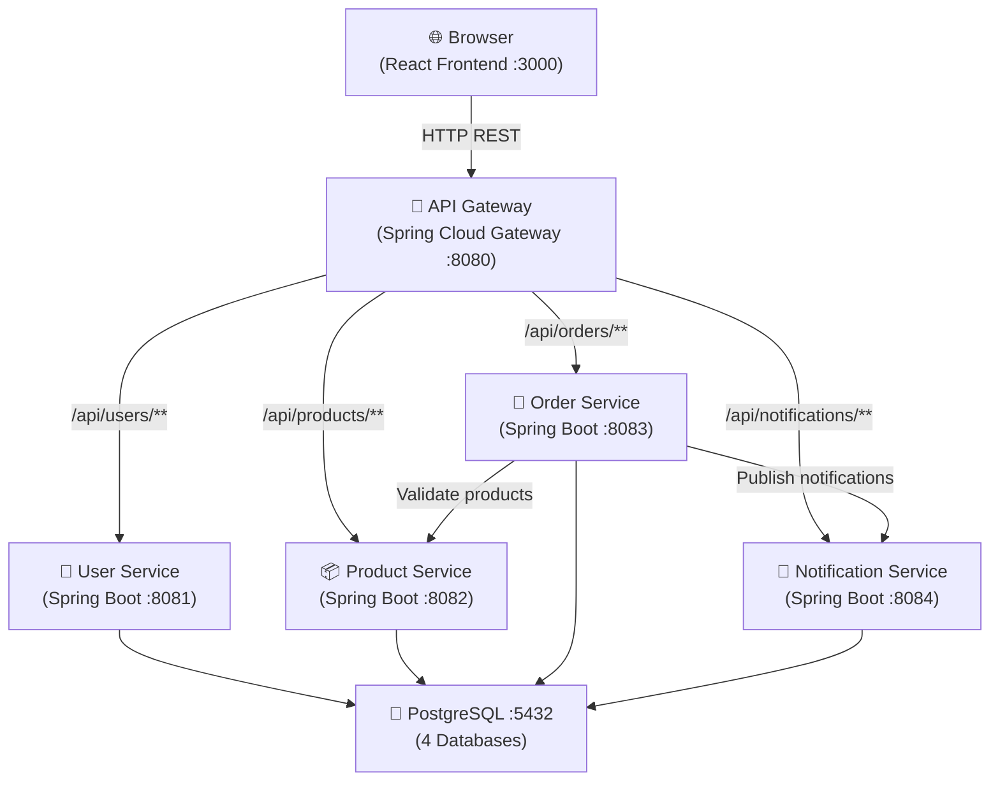

# Containerized Java Microservice Platform

> A production-ready, cloud-native microservice platform built with Java 21, Spring Boot 3, React, TypeScript, and Docker.

---

## 🏗️ Architecture Overview



---

## 🚀 Technologies Used

| Layer | Technology |
|-------|-----------|
| Language | Java 21 |
| Framework | Spring Boot 3.2 |
| Gateway | Spring Cloud Gateway |
| ORM | Spring Data JPA / Hibernate |
| Security | Spring Security (BCrypt) |
| Database | PostgreSQL 16 |
| Frontend | React 18 + TypeScript |
| HTTP Client | Axios |
| Charts | Recharts |
| Icons | Lucide React |
| Container | Docker + Docker Compose |
| Build | Maven |

---

## 📦 Microservices

| Service | Port | Description | Database |
|---------|------|-------------|----------|
| API Gateway | 8080 | Central routing, CORS, rate limiting | — |
| User Service | 8081 | Registration, login, profile management | userdb |
| Product Service | 8082 | Product CRUD, inventory management | productdb |
| Order Service | 8083 | Order lifecycle, inter-service calls | orderdb |
| Notification Service | 8084 | Event notifications, notification history | notificationdb |

---

## 📁 Project Structure

```
java-microservice-platform/
├── api-gateway/            # Spring Cloud Gateway
│   ├── src/
│   ├── Dockerfile
│   └── pom.xml
├── user-service/           # User management
│   ├── src/
│   ├── Dockerfile
│   └── pom.xml
├── product-service/        # Product catalog
│   ├── src/
│   ├── Dockerfile
│   └── pom.xml
├── order-service/          # Order management
│   ├── src/
│   ├── Dockerfile
│   └── pom.xml
├── notification-service/   # Notifications
│   ├── src/
│   ├── Dockerfile
│   └── pom.xml
├── frontend/               # React TypeScript UI
│   ├── src/
│   │   ├── api/
│   │   ├── components/
│   │   ├── pages/
│   │   └── types/
│   └── package.json
├── docker/
│   └── init-multiple-dbs.sh
├── docker-compose.yml
├── .env.example
└── README.md
```

---

## ⚙️ Prerequisites

- **Java 21** – [Download](https://adoptium.net/)
- **Maven 3.9+** – [Download](https://maven.apache.org/)
- **Docker 24+** & **Docker Compose v2** – [Download](https://www.docker.com/)
- **Node.js 18+** & **npm** – [Download](https://nodejs.org/)

---

## 🐳 Docker Setup (Recommended)

### 1. Clone & configure

```bash
git clone <your-repo-url>
cd java-microservice-platform

# Copy and configure environment variables
cp .env.example .env
# Edit .env to set your passwords (or use defaults for local dev)
```

### 2. Build & start all services

```bash
docker compose up --build -d
```

This will:
- Start PostgreSQL and create all 4 databases automatically
- Build all 5 Java microservices
- Start each service with health checks
- Expose all services on their respective ports

### 3. Verify services are running

```bash
docker compose ps
docker compose logs -f
```

### 4. Start the frontend

```bash
cd frontend
npm install
npm start
```

The app will be available at **http://localhost:3000**

---

## 🛠️ Manual Setup (Without Docker)

### Start PostgreSQL locally

```bash
# Using homebrew on macOS
brew install postgresql@16
brew services start postgresql@16

# Create databases
psql -U postgres -c "CREATE DATABASE userdb;"
psql -U postgres -c "CREATE DATABASE productdb;"
psql -U postgres -c "CREATE DATABASE orderdb;"
psql -U postgres -c "CREATE DATABASE notificationdb;"
```

### Update application.yml files

Change all `postgres` hostnames to `localhost` in each service's `application.yml`.

### Build & run each service

```bash
# Build all services
cd user-service && mvn clean package -DskipTests && java -jar target/*.jar &
cd ../product-service && mvn clean package -DskipTests && java -jar target/*.jar &
cd ../order-service && mvn clean package -DskipTests && java -jar target/*.jar &
cd ../notification-service && mvn clean package -DskipTests && java -jar target/*.jar &
cd ../api-gateway && mvn clean package -DskipTests && java -jar target/*.jar &
```

---

## 🌐 API Endpoints

### API Gateway (http://localhost:8080)

| Method | Path | Description |
|--------|------|-------------|
| GET | /health | Gateway health |
| ALL | /api/users/** | Proxied to User Service |
| ALL | /api/products/** | Proxied to Product Service |
| ALL | /api/orders/** | Proxied to Order Service |
| ALL | /api/notifications/** | Proxied to Notification Service |

### User Service (http://localhost:8081)

| Method | Path | Description |
|--------|------|-------------|
| POST | /api/users/register | Register new user |
| POST | /api/users/login | Login |
| GET | /api/users | List all users |
| GET | /api/users/{id} | Get user by ID |
| PUT | /api/users/{id} | Update user |
| DELETE | /api/users/{id} | Delete user |
| GET | /api/users/count | User count |

### Product Service (http://localhost:8082)

| Method | Path | Description |
|--------|------|-------------|
| POST | /api/products | Create product |
| GET | /api/products | List products |
| GET | /api/products/{id} | Get product |
| PUT | /api/products/{id} | Update product |
| DELETE | /api/products/{id} | Delete product |
| PATCH | /api/products/{id}/stock | Update stock |
| GET | /api/products/count | Product count |
| GET | /api/products/categories | List categories |

### Order Service (http://localhost:8083)

| Method | Path | Description |
|--------|------|-------------|
| POST | /api/orders | Create order |
| GET | /api/orders | List orders |
| GET | /api/orders/{id} | Get order |
| GET | /api/orders/user/{userId} | User's orders |
| PUT | /api/orders/{id}/status | Update status |
| DELETE | /api/orders/{id} | Cancel order |
| GET | /api/orders/count | Order count |
| GET | /api/orders/stats | Order statistics |

### Notification Service (http://localhost:8084)

| Method | Path | Description |
|--------|------|-------------|
| POST | /api/notifications | Create notification |
| GET | /api/notifications | List notifications |
| GET | /api/notifications/{id} | Get notification |
| PUT | /api/notifications/{id}/read | Mark as read |
| PUT | /api/notifications/mark-all-read | Mark all read |
| DELETE | /api/notifications/{id} | Delete |
| GET | /api/notifications/count | Count & unread |

---

## 🧪 Testing

### Run unit tests

```bash
# Test all services
cd user-service && mvn test
cd ../product-service && mvn test
cd ../order-service && mvn test
cd ../notification-service && mvn test
```

### Manual API testing (curl)

```bash
# Register a user
curl -X POST http://localhost:8080/api/users/register \
  -H "Content-Type: application/json" \
  -d '{"username":"johndoe","email":"john@example.com","password":"secret123","firstName":"John","lastName":"Doe"}'

# Create a product
curl -X POST http://localhost:8080/api/products \
  -H "Content-Type: application/json" \
  -d '{"name":"Test Product","description":"A test product","price":99.99,"stockQuantity":100,"category":"Electronics","sku":"TEST-001"}'

# Create an order
curl -X POST http://localhost:8080/api/orders \
  -H "Content-Type: application/json" \
  -d '{"userId":1,"shippingAddress":"123 Main St","items":[{"productId":1,"quantity":2}]}'
```

---

## 🐳 Docker Commands

```bash
# Start all services
docker compose up -d

# Start with fresh build
docker compose up --build -d

# View logs
docker compose logs -f [service-name]

# Stop all services
docker compose down

# Stop and remove volumes (WARNING: deletes data)
docker compose down -v

# Check service health
docker compose ps

# Scale a service
docker compose up -d --scale product-service=2
```

---

## 🔧 Environment Variables

Copy `.env.example` to `.env` and configure:

```env
DB_USERNAME=postgres
DB_PASSWORD=your_secure_password_here
```

---

## 📸 Screenshots

The application features:
- **Dashboard** – Real-time stats for users, products, orders, and service health
- **Services Monitor** – Live health check for all 5 microservices
- **User Management** – Full CRUD with search and pagination
- **Product Management** – Card-based product grid with CRUD
- **Order Management** – Order lifecycle tracking with status updates
- **Notification Center** – Real-time notification feed
- **API Documentation** – Interactive endpoint reference

---

## 🚀 Push to GitHub

```bash
cd /path/to/java-microservice-platform

# Initialize git (if not already)
git init

# Add remote
git remote add origin https://github.com/YOUR_USERNAME/java-microservice-platform.git

# Add all files
git add .

# Commit
git commit -m "feat: initial commit - Containerized Java Microservice Platform"

# Push
git push -u origin main
```

> [!TIP]
> Create a `.gitignore` before pushing to exclude `target/`, `node_modules/`, `.env`, and `*.jar` files.

---

## 🔮 Future Enhancements

- [ ] Service discovery with **Netflix Eureka**
- [ ] Distributed tracing with **Zipkin / Jaeger**
- [ ] Message broker with **Apache Kafka** for async events
- [ ] JWT-based authentication across services
- [ ] Kubernetes deployment manifests (Helm charts)
- [ ] CI/CD pipeline with GitHub Actions
- [ ] Centralized logging with **ELK Stack**
- [ ] API rate limiting per user
- [ ] GraphQL API layer
- [ ] WebSocket real-time notifications

---

## 📄 License

MIT License — feel free to use this project for learning or as a template for your own microservice platform.

